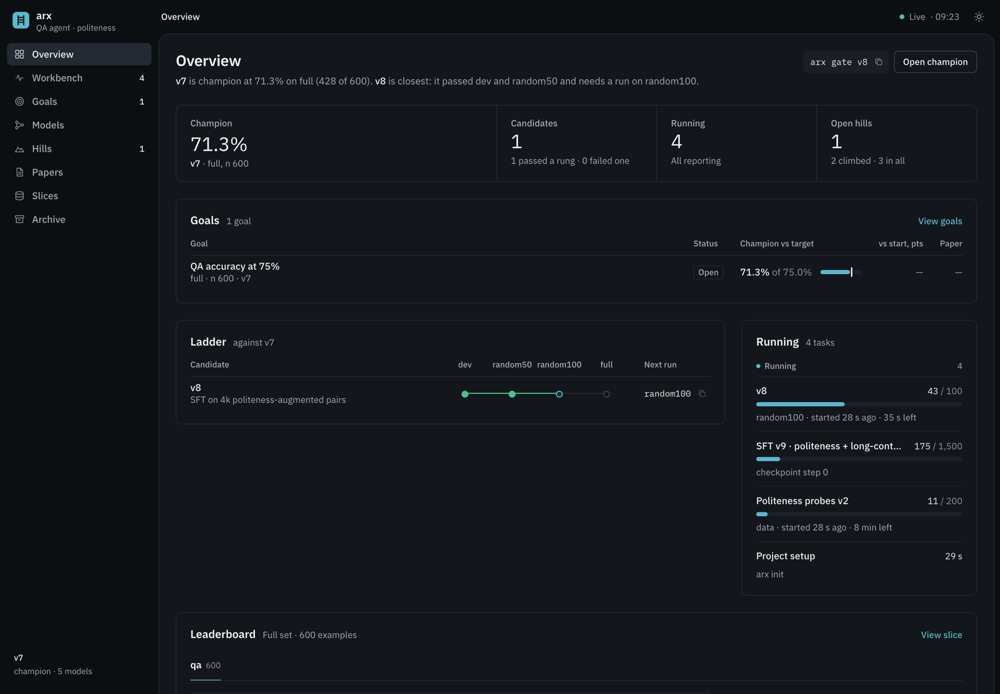
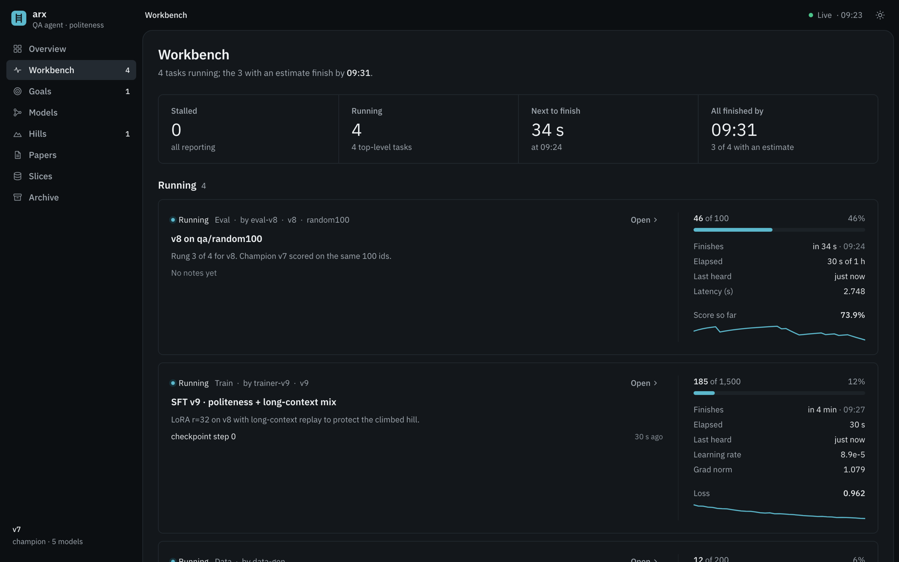
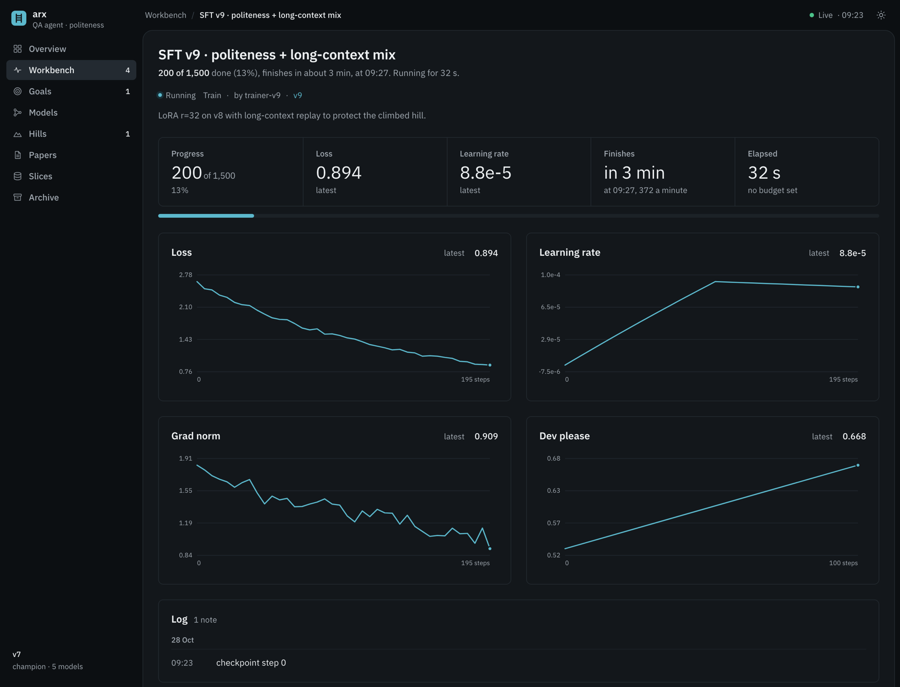
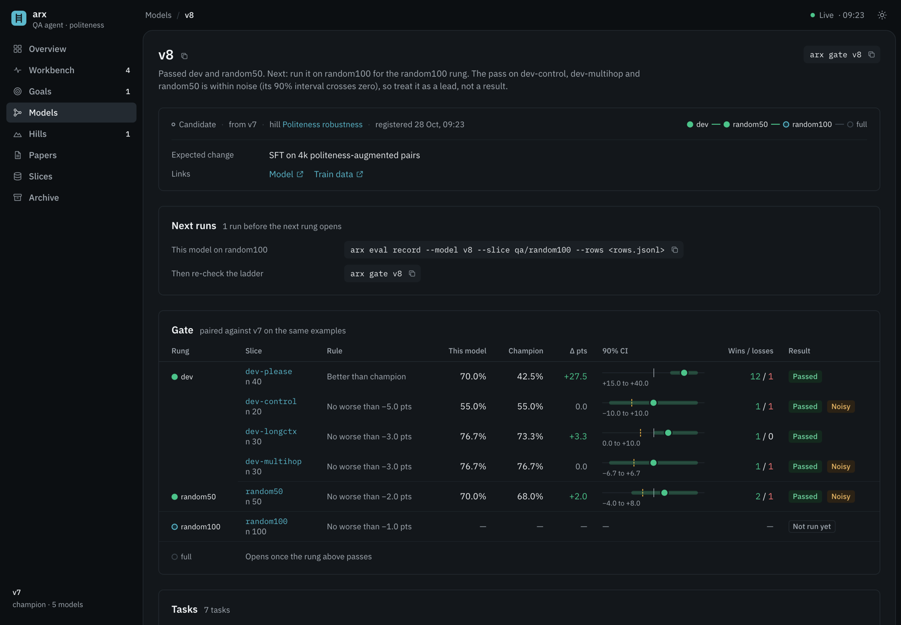
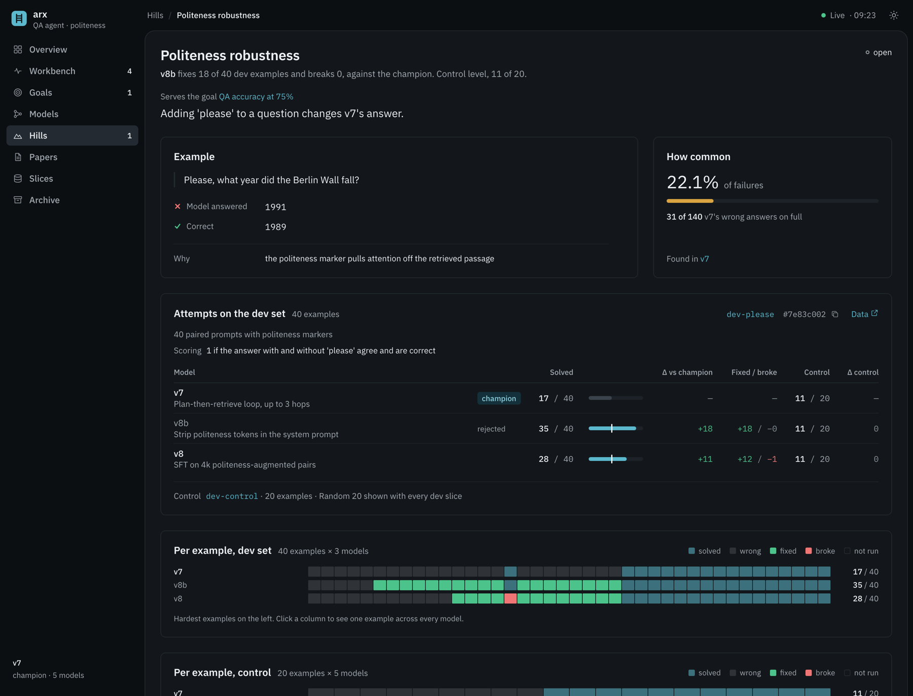
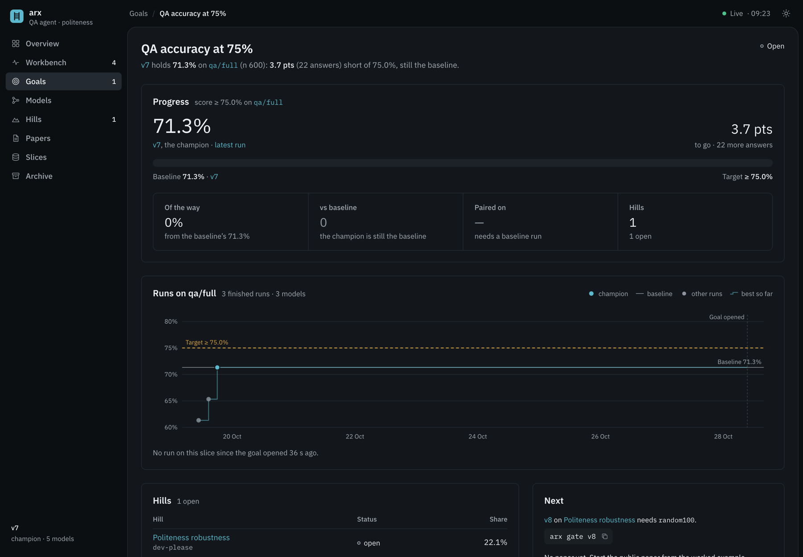

<div align="center">

# autoresearch-scaffold

**Research infrastructure for AI agents that improve models.**

A ledger, a gate ladder and a live dashboard, so an agent (or a team of subagents) can hill-climb a model against
eval sets while you watch every step.

Python stdlib only · one CLI (`arx`) · one Python API · local dashboard



</div>

<br/>

> **AI agents:** read [`AGENTS.md`](AGENTS.md) (the rules) and [`PROTOCOL.md`](PROTOCOL.md) (one research step)
> before touching a model, an eval or a slice. When unsure what to run next, run `arx gate <model>`.

# Why

Agents doing research fail in the same ways: they compare scores from different subsets, celebrate noise on 20
examples, fix one weakness and quietly break another, and run long jobs nobody can see. The scaffold makes the
right way the default:

- **Frozen slices.** Every score names an exact ID set and its hash, so comparisons are like for like.
- **A gate ladder.** A candidate climbs `dev → random50 → random100 → full` against the champion. Each rung is a
  paired comparison on identical IDs with a 90% bootstrap CI. The full eval runs only once it is earned.
- **Hills that stay climbed.** Each weakness you fix becomes a regression check for every later version.
- **Everything visible.** Setup, downloads, evals and training are tasks: live Workbench cards with progress, ETA,
  curves and notes, moved to the Archive when they end.
- **Time budgets.** Put a wall-clock cap on a task; arx enforces it on evals and every sub-task under it.

# Quickstart

## Let your agent set it up

Paste into Claude Code, Codex, Cursor or any coding agent:

```text
Install autoresearch-scaffold with `uv tool install git+https://github.com/asvskartheek/autoresearch-scaffold`,
then run `arx init <project-dir> --name "<what we are improving>"`. Read AGENTS.md and PROTOCOL.md in the new
project, give me the dashboard URL, and follow them for all research work from now on.
```

## Or by hand

```bash
uv tool install git+https://github.com/asvskartheek/autoresearch-scaffold   # `arx` on PATH (`ar` is the system archiver)

arx init my-research --name "GSM8K · Qwen 0.8B"   # starts the dashboard, opens a "Project setup" task
cd my-research
arx dataset add gsm8k --size 1319 --url https://huggingface.co/datasets/openai/gsm8k   # freezes full, random50, random100
arx model add v1 --champion --change "Baseline"
```

# One research step

```bash
# 1. Name the weakness: a target slice that shows it, a control slice that must not move
arx slice add dev-arith   --ids-file arith_ids.txt   --kind dev --description "Arithmetic slips"
arx slice add dev-control --ids-file control_ids.txt --kind control
arx hill open arith --title "Arithmetic slips" --target dev-arith --control dev-control \
    --problem "v1 sets up the problem right but miscalculates. Expect +15 pts on dev-arith; nothing else moves."
arx hill explain arith --symptom "Right setup, wrong arithmetic" \
    --example-input "17 × 24?" --example-wrong "398" --example-right "408" --share 63/495

# 2. Register the candidate and climb
arx model add v2 --hill arith --change "Calculator tool call for every operation"
arx gate v2        # names the next run: the champion's baseline first, then v2, rung by rung
arx promote v2     # only after every rung passes
arx reject v2 --reason "Broke multi-step word problems by 6 pts"   # or keep it in the ledger as a negative result
```

`arx gate` always says what to run next:

```text
v2 vs champion v1
  dev        PENDING
      need_baseline  gsm8k/dev-arith              better +0.0
      need_baseline  gsm8k/dev-control            not_worse -5.0
  random50   LOCKED
  random100  LOCKED
  full       LOCKED
next runs:
  v1 on gsm8k/dev-arith
  v1 on gsm8k/dev-control
```

# Python API

```python
import autoresearch as ar

def run_one(example_id):                   # your harness: a score in [0, 1]
    ...
    return {"score": 1.0, "latency_s": 2.1}

ar.evaluate("v2", "dev-arith", run_one, workers=8, deadline_s=1800)   # exact slice IDs; errors and timeouts score 0

with ar.task("train", "SFT v3", model="v3", config={"lr": 2e-4}) as t:   # live curves on the task page
    for step, loss in training_loop():
        t.log(step=step, loss=loss)
    t.note("Loss plateaued at 1.0; dropping lr")
    t.link("Checkpoint", "https://huggingface.co/you/v3")

with ar.task("experiment", "prompt sweep", budget_s=1800) as t:   # 30 minutes
    while t.ok():                                    # or t.check(): raises, card ends as "budget"
        ar.evaluate(next_prompt(), "dev-arith", run_one)   # the eval's deadline shrinks to the time left
```

Budgets nest: a sub-task never outlives its parent. Checks are cooperative: arx stops an eval on time, but a plain
task stops only when its code calls `ok()` or `check()`.

**From a shell:** `arx task start --title "Download weights" --budget-s 600` prints an id, then
`arx task log | note | link | progress | left | finish <id>`. Loop with `while arx task left $id; do ...; done`.
**Another harness:** `arx eval record --model v2 --slice random100 --rows rows.jsonl`, or launch a reviewed,
hash-pinned command with `arx run --manifest m.json --expected-sha256 <sha> --dry-run`.

# The dashboard

`arx up` serves it on `127.0.0.1` (it starts automatically with `arx init`). Dark by default, with a light theme one click away. It refreshes every few seconds without
disturbing open sections, focus or clicks. One dashboard serves every registered project: `arx projects` lists
them and each lives at `/p/<key>/`.

### Workbench: every running task

Progress, ETA, a sparkline of the latest metric and a heartbeat. Sub-tasks nest under the task that started them.
A task with no heartbeat for 10 minutes turns red.



### Task page: curves, notes, links

Every series logged with `t.log(...)` becomes a chart. Eval tasks also show the paired diff with the champion and a
per-example strip.



### Model page: the gate

Each rung's checks against the champion: both scores, Δ, the 90% CI, wins/losses on the paired IDs, and the next run.



### Hill page: one weakness

What goes wrong, an example, how many failures it explains, and every attempt at it on the dev set, down to which
examples each version fixed or broke.



### Goal page: the number the effort is for

The champion's value against the target, the gap in points and answers, every run on the goal's slice over time,
the hills that serve it and the next step.



### Every screen

| Screen | Shows |
|---|---|
| Goals | Each target KPI: value now, gap, paired Δ vs the starting champion, the hills that serve it |
| Overview | Champion, the candidate ladder, leaderboards by dataset and slice: score, Δ champion, errors, cost, p50/p95 |
| Workbench | A card for every running task: progress, ETA, sparkline, heartbeat. Stalled tasks turn red |
| Task page | Every logged series as a chart, paired diff with the champion, per-example strip, log, links, setup |
| Models | Lineage and rungs. A model page lists every gate check with its delta, CI and win/loss count |
| Hills | Every weakness as a card; each hill's page shows an example, how common it is and every attempt |
| Papers | Goal papers (public) and hill papers (internal), with comment threads the agent answers |
| Slices | Frozen ID sets with hash, seed, metric and dataset link |
| Archive | Finished, failed and partial tasks, each with the same full page |

# Commands

| Command | Does |
|---|---|
| `arx init [dir]` | Scaffold a project, start the dashboard, open a setup task |
| `arx up [--restart]` | Start the dashboard, or restart it after an upgrade |
| `arx sync` | Refresh the project's vendored `autoresearch/` copy and restart the dashboard |
| `arx dataset add` | Register a full eval set and its nested random slices |
| `arx slice add` | Freeze a dev / control / synthetic slice. Slices never change once frozen |
| `arx goal open \| status \| achieve \| abandon` | A target KPI on one slice; achieved only when the ledger shows it |
| `arx hill open` | Name a weakness with its target and control slices (`--goal` to serve a goal) |
| `arx hill explain` | Give a hill its symptom, example, metric and share for its page |
| `arx model add` | Register a candidate (or `--champion` for the baseline) |
| `arx run --manifest m.json --expected-sha256 <sha>` | Launch a reviewed, hash-pinned command as a task; scored runs check rows against the slice |
| `arx gate <model>` | Where a candidate stands on the ladder, and the next run |
| `arx promote <model>` | Make it champion, and mark its hill as climbed |
| `arx baseline [model]` | Run the champion on every hill and dataset slice it lacks (after `promote`, automatic with `baseline_cmd`) |
| `arx reject <model>` | Keep a failed candidate in the ledger, with the reason |
| `arx paper new \| check \| add \| edit` | Write, lint and publish a paper at `/papers/<name>` |
| `arx paper poll \| reply \| resolve` | The agent's side of comment threads |
| `arx projects [ls \| add \| rm]` | The projects one dashboard serves |
| `arx status` | What is running, where each candidate stands, which goals and hills are open |

# Goals and papers

A goal is the number the effort is for (`arx goal open gsm8k-96 --title "GSM8K at 96%" --slice gsm8k/full --target 0.96`); hills
serve it. Each goal gets one public paper, each hill an internal one. People comment on any paragraph; a new
comment goes to the agent automatically, and **Send to agent** (or typing `@agent`) hands a thread back to it.
An agent answers by running `arx paper poll` in the project. See [goals](docs/guides/goals.md) and
[papers](docs/guides/papers.md).

# Configure

`research.json` holds the datasets, KPIs and the ladder. The default ladder:

| Rung | Checks vs champion |
|---|---|
| `dev` | Hill target **better**. Hill control within −5 pts. Every climbed hill within −3 pts |
| `random50` | Within −2 pts |
| `random100` | Within −1 pt |
| `full` | **Better**: this makes a new champion |

The middle rungs are "not worse" on purpose: a targeted fix often shouldn't move a random slice, and requiring
"better" on 50 examples is a coin toss. See [`PROTOCOL.md`](PROTOCOL.md).

# Demo

The screenshots above are this demo. Scores are simulated; nothing calls a model.

```bash
git clone https://github.com/asvskartheek/autoresearch-scaffold && cd autoresearch-scaffold
python3 examples/demo/seed.py demo-project      # v5 → v6 → v7 promoted, v8b rejected, v8 mid-ladder, a goal open
cd demo-project
PYTHONPATH=.. python3 ../examples/demo/live.py &  # a live eval, a training run and a data job
PYTHONPATH=.. python3 -m autoresearch.cli up
```

# Layout

```
research.json          datasets, ladder, thresholds, KPIs
AGENTS.md  PROTOCOL.md rules for agents, and the research method
.research/             the ledger: datasets, slices, goals, hills, models, decisions, tasks/<id>/{...}, papers/<name>/{paper.html, thread.jsonl}
autoresearch/          ledger, gates, task tracker, evaluate(), dashboard server
```

The ledger is plain JSON / JSONL, so agents, scripts and the dashboard read the same files. Gate results are never
stored; they are recomputed from finished evals. Rows hold id, score, cost, latency and error only, never prompts or
outputs.

# License

MIT
