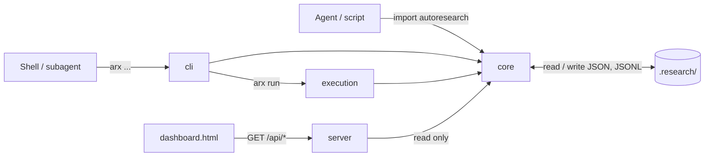

# Architecture

ARX is five files and a directory of JSON.

```text
autoresearch/
├── __init__.py      # the public API: project(), task(), evaluate(), gate()
├── core.py          # the ledger, statistics, gates, Task, evaluate()
├── cli.py           # `arx`: argparse over the same Project / Task operations
├── execution.py     # `arx run`: hash-pinned manifests, subprocess, row checking
├── server.py        # loopback HTTP server: aggregate JSON computed from the ledger
└── dashboard.html   # single-page dashboard; polls the server
```



There is one writer library (`core.py`) and many readers. The CLI, `arx run` and the Python API all go through
`Project` and `Task`; the server only reads. Because the ledger is plain files, the dashboard does not have to be
running for work to be recorded, and anything (`jq`, a notebook, another agent) can read it.

## The `.research/` ledger

```text
research.json                 # config: ladder, thresholds, KPIs, primary_dataset (project root)
.research/
├── datasets.json             # name -> {title, url, size, ...}
├── slices.json               # "dataset/slice" -> {ids, n, hash, kind, seed, hill, metric, url}
├── hills.json                # name -> {title, target, control, problem, status, symptom, examples, share, ...}
├── models.json               # name -> {parent, hill, change, status: champion|candidate|retired|rejected|...}
├── decisions.jsonl           # append-only: champion seeded, promote (with the gate snapshot), reject
├── server.json               # dashboard port, pid, start time
├── server.log
└── tasks/<id>/
    ├── task.json             # status, kind, model, slice, slice_hash, parent, progress, budget_s, summary
    ├── metrics.jsonl         # one line per log(): {t, step, loss, ...}
    ├── events.jsonl          # notes: {t, level, msg}
    ├── rows.jsonl            # evals only: {id, score, cost, latency_s, error}
    ├── manifest.json         # `arx run` only
    └── stdout.private.log    # `arx run` only (and stderr.private.log)
```

Writing rules that keep concurrent writers safe without a lock server:

- **Collections** (`*.json`) are rewritten whole via a temp file and `os.replace`, which is atomic. Updates are
  upserts that merge fields, and `None` never overwrites.
- **Streams** (`*.jsonl`) are append-only. The reader skips a line it cannot parse, because a writer may be
  mid-line.
- **Task IDs** are `MMDD-HHMMSS-<kind>-<4 hex>`, so directories sort by time and never collide across processes.
- Derived states are computed on read and never written: `stalled` (no heartbeat for `stall_minutes`), gate results,
  leaderboards, ETAs.

`rows.jsonl` is gitignored by `arx init`: rows from private datasets never get committed.

## `core.py`

- **`Project`** finds the root (the nearest directory with `research.json`), and owns collections: datasets, slices
  (freezing and hashing), hills, models, decisions, tasks, and `gate()` / `promote()`.
- **Statistics**: `summarize(rows)` (n, mean score with errors as 0, cost, latency p50/p95), `per_id(rows)` (mean
  per ID, averaging repeats), `paired(cand, base)` (paired delta, 90% bootstrap CI, wins/losses).
- **`Task`** writes `task.json` on creation and on every update (which is also the heartbeat). Re-opening an existing
  ID (`Task(p, "", "", tid=...)`) loads it instead; this is how each `arx task ...` shell call acts on a task.
- **`evaluate()`** wraps a `Task` of kind `eval` around a thread pool.

## Task nesting via `$ARX_PARENT`

A task's `parent` is resolved once, at creation, in this order:

1. an explicit `parent=` / `--parent`,
2. the innermost task still open **in this process** (module-level stack `_open`),
3. the `ARX_PARENT` environment variable,
4. none.

```text
with task("experiment", "sweep")        # _open=[sweep]   ARX_PARENT=sweep
    evaluate(...)                       # parent=sweep (evals are leaves: not pushed)
    with task("train", "ft")            # parent=sweep   _open=[sweep, ft]   ARX_PARENT=ft
        subprocess.run(["arx", "task", "start", ...])  # child process reads ARX_PARENT=ft
    # ft finishes: popped, ARX_PARENT=sweep again
# sweep finishes: ARX_PARENT restored to what it was before sweep started
```

When a non-eval task starts, it pushes itself on `_open` and sets `os.environ["ARX_PARENT"]` to its ID. Because
child processes inherit the environment, anything a task launches nests under it with no plumbing. On `finish()` it
pops and restores the previous value. `arx run` sets `ARX_PARENT` explicitly in the child's environment.

For tasks written before `parent` existed, the server's `infer_parents` nests a task under the newest non-eval task
with the same host, pid and command that was running when it started.

## Time budgets inside

`task.json` has a top-level `budget_s` (or `null`).

- `left()` walks up the `parent` chain (ancestors live in this process from memory, others from disk) and returns
  the minimum of `budget_s − (now − created)` over every task that has one, or `None` if none do. So the tightest
  cap anywhere above wins.
- `ok()` is `left() is None or left() > 0`; `check()` raises `BudgetExceeded` when `ok()` is false.
- In `__exit__`, a `BudgetExceeded` whose message starts with this task's ID is swallowed (status `budget`); one for
  an ancestor finishes this task as `budget` and keeps propagating.

## How gates are derived

`Project.gate(model)` is a pure function of the ledger; nothing it returns is stored.

```text
gate(candidate)
  champ = the model with status "champion"
  for rung in research.json ladder
    for check in rung.checks
      slices = resolve(check.slice)          # @hill.target, @hill.control, @hills.climbed, or a slice name
      for slice in slices
        base = latest_eval(champ, slice)     # finished, complete, slice_hash == current hash
        cand = latest_eval(candidate, slice)
        missing base  -> need_baseline, add (champ, slice) to next
        missing cand  -> need_run,      add (candidate, slice) to next
        both          -> paired(per_id(cand rows), per_id(base rows)) -> pass | fail
    rung status from its check states
    stop at the first pending rung; later rungs are locked
  promotable = every rung pass or skipped
```

Key consequences:

- **Only finished, complete evals count**: `kind == "eval"`, `status == "done"`, `complete == True`. A partial or
  failed run is invisible to gates.
- **The hash must match.** An eval on an older version of a slice name does not count.
- **The latest run wins** (by `ended`), so re-running the champion after a harness change replaces its baseline.
- **`@hills.climbed`** expands to every climbed hill's target except the candidate's own, so the `dev` rung grows as
  the project learns.
- `promote` re-runs `gate()` and snapshots it into `decisions.jsonl`.

## `server.py` and `dashboard.html`

`arx serve` binds `127.0.0.1` only and serves:

| Route | Returns |
|---|---|
| `/` | `dashboard.html` |
| `/api/state` | config, slices (without ID lists), hills, models, every candidate's gate, tasks with latest note, sparkline and ETA, leaderboard, last 50 decisions |
| `/api/task/<id>` | the task, metrics (downsampled to ~600 points), last 300 events; for evals, rows and the paired diff vs the champion |
| `/api/hill/<name>` | per-example scores of every model on the hill's target and control |
| `/api/gate/<model>` | `gate()` |

Everything is computed per request from the files, with `Cache-Control: no-store`. The dashboard is a single HTML
file with no build step; it polls `api/state` every few seconds and fetches detail routes for task and hill pages.

## `cli.py`

An argparse front over the same operations. Notable behaviour beyond a thin wrapper: `init` vendors the package and
opens the setup task; `up` manages the detached server via `server.json`; `task left` exits 3 when time is up; task
subcommands warn when the dashboard is not running. See the [CLI reference](reference/cli.md).

## `execution.py`

`check_manifest` validates everything before any process starts; `_run` runs `argv` in a new session with a deadline
and heartbeats; `_collect_rows` reconciles output rows against the slice. See [`arx run` manifests](guides/run.md).
