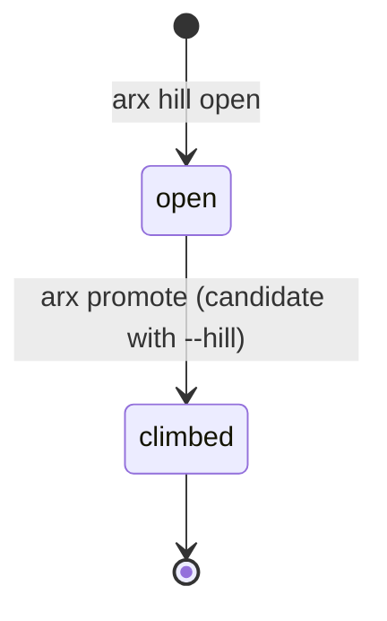

# Hills

A **hill** is one specific weakness of the champion, named and measured: "v7 flips answers when the prompt says
*please*", "v1 sets up the problem right but miscalculates".


## Why hills

"Make the model better" is not something you can test. A hill turns it into a claim with a target slice that
measures it, a control slice that catches collateral damage, and a pre-declared expectation. Once a candidate climbs
it and is promoted, the hill's target slice becomes a **permanent regression check**: every future candidate's
`dev` rung re-runs it. Hills stay climbed.

## Opening a hill

1. **Find it.** Error analysis on the champion's full run: cluster the failures and name one.
2. **Build the development set.** A target slice (real failures, synthetic probes, or both; small, 20–60) and a
   control slice (a small random sample).
3. **Open and pre-declare.**

```bash
arx hill open arith --title "Arithmetic slips" --target dev-arith --control dev-control \
    --problem "Right plan, wrong arithmetic. Expect +15 pts on dev-arith; control and random slices unchanged."
```

`--problem` is where you write, *before* running anything, what the change should move and what would count as
failure. Do not edit thresholds after seeing results. `found_in` defaults to the current champion.

## Explaining a hill

Every hill gets an explainer, so its page makes sense to someone who missed the chat:

```bash
arx hill explain arith \
  --symptom "The reasoning is right but a calculation is wrong." \
  --example-input "A shirt costs \$18 and is 25% off. What is the price?" \
  --example-wrong "18 × 0.25 = 4.2, so 18 − 4.2 = 13.8" \
  --example-right "18 × 0.25 = 4.5, so 18 − 4.5 = 13.5" \
  --example-why "Right plan, wrong multiplication." \
  --measure "A problem counts as solved when the final number equals the reference answer." \
  --share 63/495 --share-of "of v1's wrong answers on full contain a false equation"
```

| Field | Rule |
|---|---|
| `--symptom` | One plain sentence about behaviour. No jargon, slice names or expectations. |
| `--example-*` | One short typical case. Each call appends one; give 2–3, or `--examples-file` (JSON list of `{input, wrong, right, why}`). Illustrative paraphrases only, never client text. |
| `--measure` | When one target example counts as solved. |
| `--share`, `--share-of` | How many failures this hill explains, out of what. Real counts only. |

## Lifecycle



A candidate claims a hill with `arx model add v2 --hill arith`. When it is promoted, the hill is marked `climbed`
with `climbed_by: v2`.
